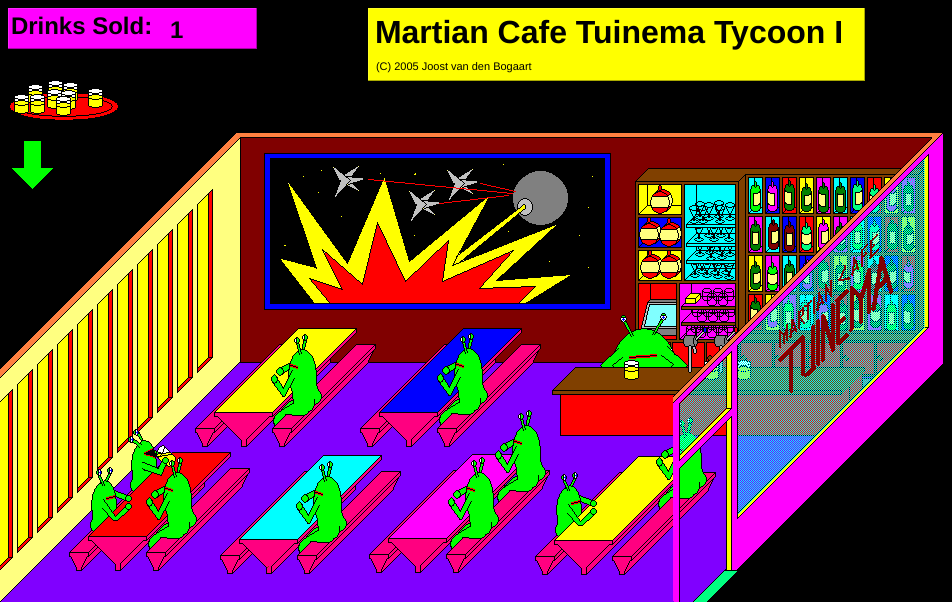
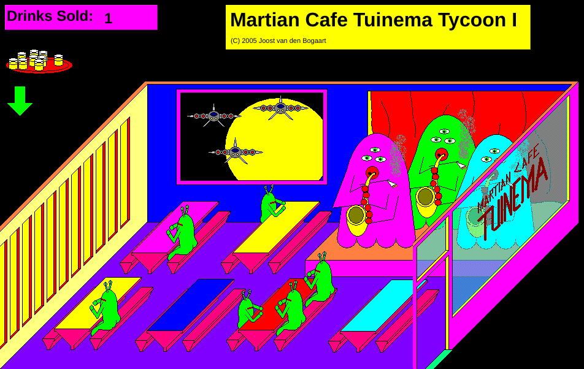

# Martian Café Tuinema Tycoon

Martian Café Tuinema Tycoon is a bartender game
in which you serve beer to a café full of thirsty Martians.
It was written by Joost van den Bogaart in 2005
and is one of
[Richèl Bilderbeek's games](https://richelbilderbeek.github.io/games).





## Building the game

The game was originally written in C++Builder using the VCL,
which can be found in the
[v1.0 release](https://github.com/richelbilderbeek/MartianCafeTuinemaTycoon/releases/tag/v1.0).
It now uses Qt and is built by continuous integration:

- [The Linux build script](https://github.com/richelbilderbeek/MartianCafeTuinemaTycoon/blob/master/.github/workflows/build_linux.yaml)
  checks that the game builds on Linux
- [The Windows build script](https://github.com/richelbilderbeek/MartianCafeTuinemaTycoon/blob/master/.github/workflows/build_windows.yaml)
  creates a zip file with the Windows executable,
  which can be downloaded from the workflow run

To build the game locally:

```bash
mkdir build
cd build
qmake ../martiancafetuinematycoon.pro
make
```
